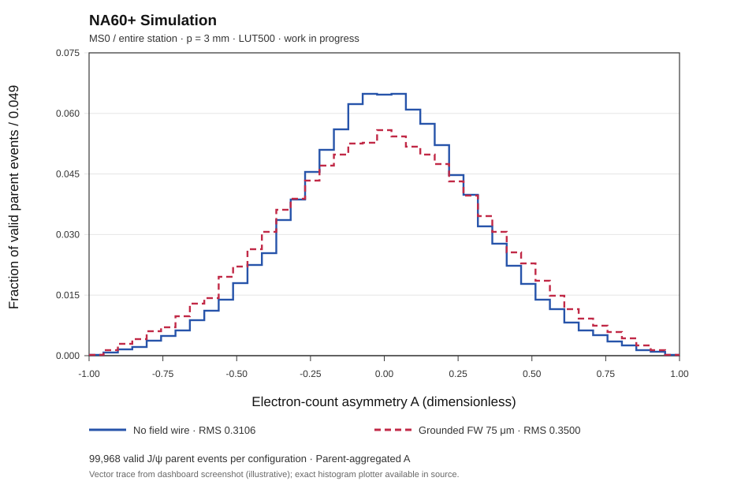

# Supporting note: provisional no-field-wire reference for NA60+ MWPC (MS0)
**For discussion with A. Milov | 6 November 2026 | NA60+ Simulation — Work in progress**

**Status:** provisional **simulation baseline**, not a final chamber-design recommendation. This note addresses the decision **with versus without a grounded 75 μm field wire at fixed 3 mm anode pitch**. It **does not decide 3 versus 4 mm pitch**; that comparison is deferred until the signal-response study.

**Documents in this living set:** **(1) This short scientific supporting note** · [**(2) technical evidence and reproducibility log**](PI_P3_FIELD_WIRE_TECHNICAL_EVIDENCE_LOG.md) · [**(3) avalanche and signal-response follow-up plan**](PI_P3_FIELD_WIRE_SIGNAL_RESPONSE_FOLLOWUP_PLAN.md).

Earlier full combined text is [archived intact](PI_P3_NOFW_COMBINED_WORKING_NOTE_ARCHIVE_2026-11-06.md). Raw data and detailed numerical pilots are kept in the technical log; tasks and new work belong in the follow-up plan.

## 1. Question and current recommendation

**Question.** For the preliminary NA60+ MWPC configuration with **3.0 mm anode pitch**, does the addition of grounded **75 μm midpoint field wires** improve the symmetry of the *primary electrons reaching the anode*? This comparison screens a proposed geometry before studying avalanche multiplication and the final cathode/strip signal.

**Working choice:** continue the subsequent avalanche and signal studies using **P3_NOFW (3 mm, no field wires)** as the **reference**. The principal result is a **narrower parent-event distribution of full-hemisphere electron-count asymmetry in the complete MS0 station**, together with higher collected-electron fraction in the independent transport study.

This is *not* a statement that the detector without field wires necessarily gives better **cathode-charge balance**, **spatial single-hit resolution**, **detection efficiency**, **timing resolution** or **double-hit resolution**. The restricted cathode-facing-sector asymmetry favors FW75, and amplification/induction may change which geometry is preferable.

## 2. Geometry, observable, and model boundary

| Parameter | Reference | Alternative |
|:--|:--|:--|
| Anode pitch | 3.0 mm | 3.0 mm |
| Field wire | none | grounded, 75 μm diameter, midway between anodes |
| Cathode distances | symmetric ±3 mm | symmetric ±3 mm |
| Anode diameter / bias | 30 μm / +1800 V | 30 μm / +1800 V |
| Gas, conditions | Ar/CO₂ 70:30, 293.15 K, 760 Torr, B=0 T | same |

The principal analysis starts with **native Geant4 J/ψ muon gas crossings**, samples primary ionization using a **Heed-calibrated marked-Poisson model along those chords** and propagates primary electrons with **frozen Garfield transport LUT500 maps**. It is **not** a direct TrackHeed-plus-full-avalanche simulation of each parent, and it has **no cathode signal or frontend electronics**. Its microscopic lookup histories are reused, so the 100k generated J/ψ parents must not be misrepresented as 100k independent Garfield histories.

Define the full-hemisphere **anode endpoint count** asymmetry

\[
A_{\mathrm{hemi}}=\frac{N_{\mathrm{up}}-N_{\mathrm{down}}}{N_{\mathrm{up}}+N_{\mathrm{down}}},
\]

where "up" means anode-surface impact-position azimuth `0<φ_hit<180°`, and "down" means `−180°<φ_hit<0`. Exact boundaries are excluded. **Undefined A** (zero classified endpoints) is not set to zero.

For **MS0 entire station**, first combine every classified electron endpoint from **all muon gas crossings and physical chambers in MS0 belonging to the same J/ψ parent**. Compute one A for each parent with a defined denominator; each defined parent contributes equally to `P(A)`. This is **not** the one-A-per-gas-crossing definition used in a separate LUT20 study.

A narrower `P(A_hemi)` is a **screening-level indication of reduced event-to-event fluctuation in upper/lower electron counts** at the anode. It cannot, without subsequent modeling, be equated with a narrower distribution of *measured cathode charges* or a lower reconstructed position RMS.

## 3. Principal result: entire MS0 station, parent-event LUT500

Two complete native Geant4 input chunks contain **100,000 generated J/ψ parent slots**. Of these, **99,968 parents have a muon gas crossing in MS0**, and all 99,968 have defined A in each geometry.

| Whole-MS0, 3 mm pitch, LUT500 | No field wire | Grounded FW75 |
|:--|--:|--:|
| Parents with MS0 crossing / valid A | 99,968 / 99,968 | 99,968 / 99,968 |
| Undefined A | 0 | 0 |
| Mean A | +0.0008 | −0.0014 |
| **Population RMS(A)** | **0.3106** | **0.3500** |
| Classified electron endpoints | 8,524,668 | 8,242,284 |

**Observed width reduction:** `ΔRMS = RMS_FW75 − RMS_noFW = 0.0394`, or approximately **11.3% lower RMS without field wires relative to FW75**. Both means are near zero: the argument is a **difference in widths**, not a meaningful difference in average sign. The noFW geometry also produces **~3.43% more classified endpoints**, which can affect counting-statistics fluctuations and should not be treated as an independent proof of intrinsic symmetry.

**Figure 1.** Parent-aggregated `P(A_hemi)` over the **whole MS0 station**, p=3 mm/LUT500; **blue solid:** no field wire; **red dashed:** grounded 75 μm field wire. Vertical axis is fraction of *valid parent events per ΔA≈0.049 bin*, with 41 bins on [-1,1].



*Figure provenance:* the embedded SVG is an **illustrative vector trace of the 6 November dashboard screenshot** (which reports the numerical statistics above); its bin heights have **not** been independently re-extracted from the saved source data. For a final technical or Overleaf figure, **replace this placeholder with the exact 41-bin plot** produced from the frozen `summary.json`:

```bash
cd ~/na6p/src/NA6PRoot-mwpc
python test/mwpc-stage-c/plot_pi_ms0_station_parent_asymmetry.py \
  --summary test_runs/mwpc_stage_c/pi_lut500_parent_asymmetry_root_v1/summary.json \
  --output test/mwpc-stage-c/figures/ms0_station_parent_A_p3_LUT500.png
```

The source plotter explicitly uses **`stations["0"]["station_parent"]`** and performs no new Geant4/Heed/Garfield run. The rounded table above comes from the complete-station dashboard screenshot and has not yet been re-checked against the frozen `summary.json` in this revision. The [technical log](PI_P3_FIELD_WIRE_TECHNICAL_EVIDENCE_LOG.md) records dataset provenance and the needed verification.

## 4. Supporting transport evidence and the important counterexample

An independent **full-cell microscopic Garfield pilot**, with **18,000 initial electrons per p3 configuration**, found the following:

| Observable | No field wire | Grounded FW75 |
|:--|--:|--:|
| Electrons collected at anode | 14,875 | 14,258 |
| **Anode collection fraction** | **82.64%** | **79.21%** |
| Conditional mean drift time of collected electrons | 27.152 ns | 26.614 ns |
| Conditional drift-time RMS of collected electrons | 14.949 ns | 14.727 ns |

The no-FW option collects ~**3.43 percentage points more** primary electrons under these conditions. FW75 shows a ~0.54 ns lower **conditional** mean drift time, but this is **not** an established gain in detector timing resolution: field wires may select a different surviving-electron population. The timing-difference uncertainty remains to be evaluated.

A separate **100k-parent, six-station, LUT20** study, defining one A **per physical muon gas crossing**, yielded full-hemisphere RMS **0.36490 noFW** vs **0.40066 FW75**. However, defining only the **cathode-facing ±45° sectors**, the trend **reverses**: RMS(A_TB) **0.61871 noFW** vs **0.45675 FW75**. This is a relevant warning against the general statement that noFW always yields better upper/lower signal balance. The two analyses use different statistical units and, for LUT20, fewer independent microscopic histories per cell; they must not be directly pooled with the whole-MS0 LUT500 distribution.

## 5. Decision, boundaries, and next test

**Decision for the current research stage:** adopt **P3_NOFW as the working no-field-wire reference** for further simulation because the **complete MS0 parent-event electron-count asymmetry is narrower**, with supporting primary-electron collection evidence. This reduces unneeded geometry complexity at the exploratory stage, but it does not settle hardware design.

**Outstanding issues that could reverse the decision:** electron-count multiplicity effects; parent-correlated finite-LUT uncertainty; position/angle dependence; avalanche gain and ion-birth topology; positive-ion transport and Shockley–Ramo induced cathode charge; time windows; U/V strip signals, shaping, thresholds, and occupancy. In particular, the restricted-sector counterexample must be resolved with an actual `A_Q(T)` calculation. No claim of improved reconstruction performance is made here.

**Pitch selection deliberately deferred:** neither these results nor the fixed-position 5/100-seed gas-gain feasibility tests establish that a **3 mm** pitch is preferable to **4 mm**. We will **return to 3 versus 4 mm when studying the full signal response**, ideally at comparable effective gain and with metrics tied to actual strip and tracking performance. Until then **3 mm is the working reference, not an optimized pitch**.

For detailed numbers, original source identification, code and open validation issues see the [technical evidence log](PI_P3_FIELD_WIRE_TECHNICAL_EVIDENCE_LOG.md). The [follow-up plan](PI_P3_FIELD_WIRE_SIGNAL_RESPONSE_FOLLOWUP_PLAN.md) defines the B1 (ion births), B2 (avalanche endpoints), B3 (cathode charge) and strip/ASIC stages.

---

### Revision / new evidence register

- **2026-11-06 (v1.0):** reorganized the former combined note; fixed the current recommendation to **p3 noFW provisionally**, based on **whole-MS0, parent-level LUT500 RMS**; **p3 vs p4 deferred to signal-response work**. No new physics calculations performed in this editorial revision.
- **Next update (pending):** replace traced Fig. 1 with exact frozen-bin plot, attach uncertainty analysis and update the decision only if validated evidence changes its interpretation.
